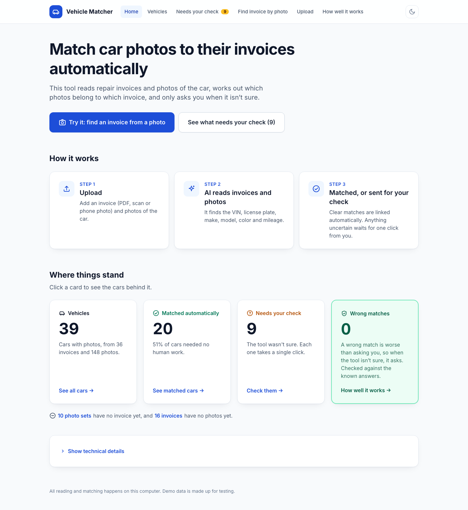
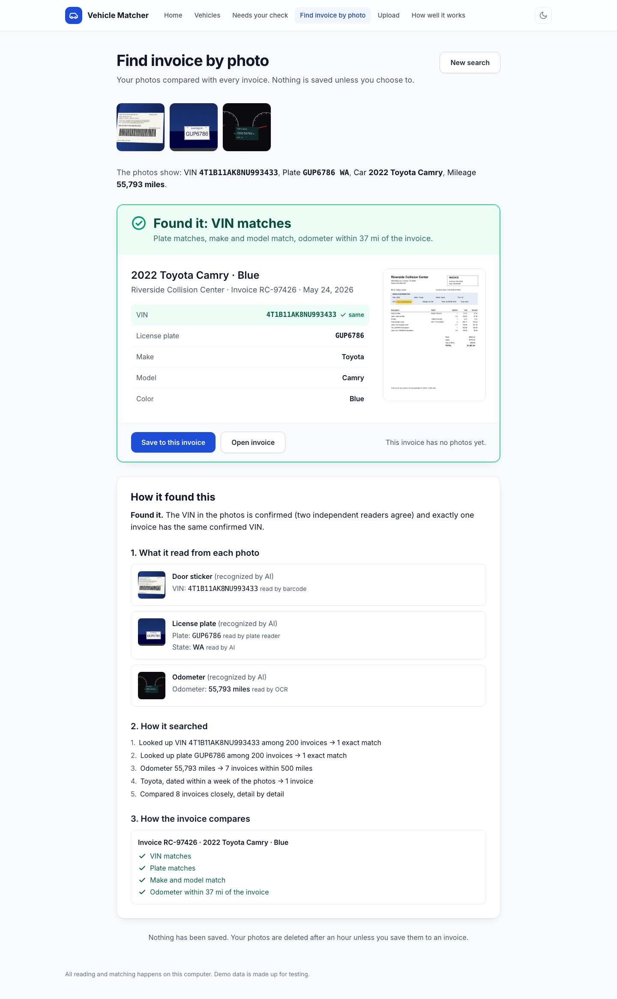
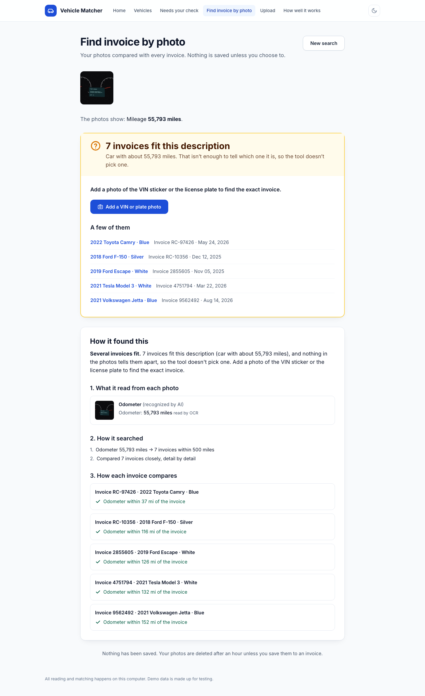
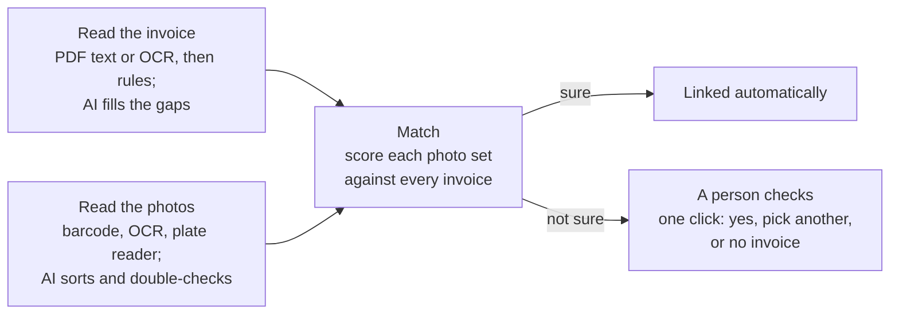

# Vehicle Matcher

**Snap a photo of a car, get its repair invoice: matched automatically, with a person asked only when it isn't sure.**



## What it does

A body shop or dealership collects thousands of repair invoices and car photos, and someone has to work out which photos belong to which invoice.
This app reads both, the invoices (PDFs, scans, phone photos) and the car photos (VIN sticker, license plate, odometer, outside), with OCR and a local AI model.
It matches them automatically when it is sure, and sends only the uncertain cases to a person, who answers with one click.

## Demo

A realistic setup: **200 repair invoices** from the past 12 months already in the system, many of them look-alikes (the same model and color). Someone on the lot takes **a brand-new photo of a car** and asks the app to find its invoice.

The app reads the photos, searches the invoices and shows the match. A **How it found this** panel explains the result in plain words: what it read from each photo and with which reader, how it searched, and which details agree.

▶ **Demo video:** [coming soon](VIDEO_LINK_HERE)

**Found it**: a VIN sticker, plate and odometer photo of a car the app has never seen, matched to its invoice among 200.



**N invoices fit this description**: an odometer photo alone fits several invoices, so the app doesn't guess. It asks for a VIN or plate photo instead.



Run the demo yourself: [Quick start](#quick-start).

## Results

| | Without AI (rules + OCR) | With the AI model |
|---|---|---|
| Invoice details read correctly: scanned invoices | 47% | **72%** |
| Invoice details read correctly: phone photos of invoices | 58% | **76%** |
| Cars matched with no human work | 34% | **51%** |
| Wrong automatic matches | **0** | **0** |
| Wrong VINs trusted (invoices and photos) | **0** | **0** |

**Speed among 2,000 invoices:** finding and comparing the candidate invoices takes **1–30 ms** per lookup, thanks to database indexes. Reading the photos is what takes time: a few seconds per photo with OCR, about 25 seconds with the AI model on an 8 GB laptop. A VIN seen for the first time also asks NHTSA's free VIN decoder once (about 0.3 s, then cached).

**What these numbers are, and aren't.** They come from **synthetic development data**: 36 made-up invoices in 3 layouts, each as a digital PDF, a scan and a phone photo, plus 148 car photos (generated VIN plates, stickers, odometers and plates, and real exterior photos from Wikimedia Commons). **Next:** the held-out test set (2 invoice layouts the rules were never tuned on) and real-world invoices and photos. Detailed reports are in [`results/`](results/).

## How it works



- **Read the invoice:** digital PDFs are read from their text; scans and photos with OCR. Rules find each field, the VIN must pass its check digit, and the AI model fills in only what is still missing.
- **Read the photos:** the AI sorts each photo (VIN sticker, plate, odometer, outside). A barcode reader, OCR and a plate reader read the details, and the AI double-checks them and adds color and body style.
- **Match:** photos are grouped per car, then scored against the invoices by VIN, plate, make and model, color, date and mileage.
- **Linked automatically:** a VIN or plate confirmed on both sides, or a high score with a clear lead, links on its own.
- **A person checks:** everything else waits for one click: "Yes, same car", "Pick a different invoice" or "No invoice for this car". Every answer is recorded and can be undone.

## Key design decisions

**Rules first, AI fills gaps.** The cheapest and most reliable reader goes first: the PDF's own text, then a barcode, then OCR and rules. The AI model only fills fields that are still empty or low-confidence, so it adds accuracy without becoming a single point of failure.

**The AI never decides a VIN or plate on its own.** A VIN counts as confirmed only from a reliable source (a barcode, or a digital PDF's own text) or when two independent readers agree (OCR plus the AI, or OCR plus the official NHTSA decode). A plate is confirmed only when the plate reader and the AI agree on a close-up. A value read only by the AI can support a match, but never make one.

**A wrong match is worse than an extra human check.** Any disagreement on a VIN or plate blocks an automatic link, and a confirmed VIN or plate that disagrees rules the invoice out. When in doubt the app asks: in testing that cost a few extra checks and gave **0 wrong automatic matches**.

**The test data generator and the extractor are kept independent.** The invoices and photos are generated with their answer key by [`tools/make_fixtures.py`](tools/make_fixtures.py); the app never imports it or reads the key. The rules were tuned only on 3 development layouts, and 2 held-out layouts are reserved for the final check, so the results aren't flattered by testing on what was tuned.

**Runs locally on an 8 GB laptop with free, open-source tools.** pdfplumber, PaddleOCR, zxing-cpp (barcodes), fast-alpr (plates) and a 4-billion-parameter vision model (`qwen3.5:4b`) via Ollama. OCR and the AI model never run at the same time, so memory stays within 8 GB. The only outside call is NHTSA's free VIN decoder (optional); the web page loads its styling from public CDNs.

---

## For engineers

### Quick start

```bash
uv venv --python 3.12 && uv pip install -r requirements.txt
uv pip install -r requirements-ocr.txt --excludes requirements-ocr-excludes.txt   # PaddleOCR, fast-alpr
ollama pull qwen3.5:4b-q4_K_M                                                     # optional AI model

# The scale demo: 200 invoices (or --count 2000, ~3 min), fresh photos in ~/Desktop/demo_photos/
WIKIMEDIA_CONTACT=<your email or URL> python tools/fetch_exteriors.py   # real exterior photos, once
python tools/seed_scale_demo.py
DATA_DIR=data/scale DATABASE_URL=sqlite:///data/scale/app.db OLLAMA_MODEL=qwen3.5:4b-q4_K_M uvicorn app.main:app
python tools/reset_scale_demo.py                         # back to the starting state, in seconds
```

Exterior photos come from Wikimedia Commons (licenses and authors in [`tests/fixtures/exteriors/exteriors.csv`](tests/fixtures/exteriors/exteriors.csv)). The smaller demo with review cases: `python tools/make_fixtures.py --difficulty hard && python tools/seed_demo.py`, then `uvicorn app.main:app`.

### Stack and layout

FastAPI, Jinja2, HTMX and Tailwind (no build step), SQLite via SQLAlchemy.

```
app/extract/   invoice.py, photo.py, vin.py, vision.py   reading invoices and photos
app/match/     cluster.py, score.py, config.py           grouping photos, scoring, thresholds (one config file)
app/lookup.py  Find invoice by photo                     indexed search, explanation
app/           main.py, services.py, jobs.py, models.py  web app, review actions, background jobs
tools/         make_fixtures.py, seed_*.py, *_accuracy.py  test data, demo data, accuracy reports
results/       accuracy reports behind the numbers above
```

Tests: `pytest` (623 tests: VIN rules, extraction, clustering, scoring, the indexed search against a full scan, and the web pages).
